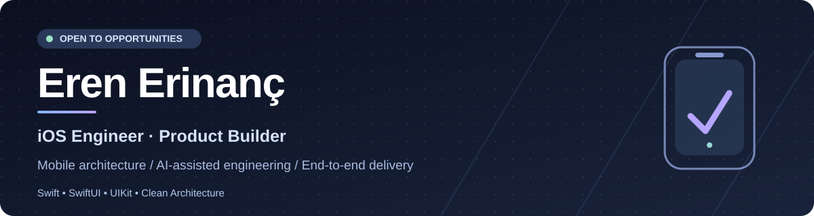

 

### Hi, I'm Eren 👋

I'm a **Senior iOS Engineer with 5+ years of experience**, building and improving native applications across **e-commerce, fintech, and consumer products**, including experiences used by millions of people.

I enjoy turning complex product requirements into reliable, maintainable mobile experiences: from **architecture and reusable UI systems** to **testing, release, and iteration**. Outside my professional roles, I independently design and build iOS products, combining an **end-to-end product mindset** with carefully reviewed **AI-agent-assisted development**.

🌍 **Currently exploring iOS / Senior iOS / Mobile Engineering opportunities. Open to remote roles and international relocation.**

---

## ✨ Selected work

### 🌙 [Bliss Dream Journal](https://apps.apple.com/app/id6814809079) · **Live on the App Store**

An independently built, AI-powered dream journal for capturing dreams and exploring interpretations from different psychological perspectives.

- **Ownership:** Product discovery, UX, iOS architecture, native SwiftUI implementation, backend integrations, testing, subscriptions, and App Store release.
- **Engineering:** Generative AI APIs, Firebase Authentication, Firestore, Cloud Functions, StoreKit, environment configuration, and release diagnostics.
- **Development workflow:** Cursor Agent Mode with Claude Opus and Grok for multi-file implementation and refactoring, with manual architecture/code reviews, testing, and TestFlight validation.

**[↗ View Bliss on the App Store](https://apps.apple.com/app/id6814809079)**

### ⏱️ Winli · **In development**

An independently developed SwiftUI productivity app centered on focus, momentum, and thoughtful interactions.

- **Ownership:** Product direction, UX, native iOS development, custom animation, reusable components, and quality verification.
- **Engineering:** Timer-driven experiences, custom interactions, and AI-agent-supported iteration with independent review of code and tests.

*App Store link will be added once Winli is published.*

> My independent products are currently developed in private repositories. I can discuss architecture, technical decisions, testing strategies, and trade-offs without exposing proprietary code.

---

## 🏗️ Engineering experience

| Role | Experience & impact |
| --- | --- |
| **Trendyol** · Software Engineer, iOS / BFF   *Sep 2025 – Jul 2026* | Built high-traffic **search and discovery** experiences for an app serving millions. Worked with Swift, UIKit, SwiftUI, modular VIPER, and **Go-based mobile BFF** on sponsored placements, A/B experiments, reliability, and performance. |
| **Ozan SuperApp** · iOS Developer   *Nov 2023 – Aug 2025* | Helped migrate **~80% of active screens** to a modular **Swift Package Manager** architecture. Defined interface-based module communication, built reusable SwiftUI foundations, and delivered onboarding, KYC, transfers, and payments. |
| **TOD (via One Team)** · iOS Developer Consultant   *Sep 2024 – May 2025 · Concurrent contract* | Integrated push and analytics SDKs, built **backend-driven interfaces** using HATEOAS-style API responses, and configured shared modules with **Tuist and Clean VIP**. |
| **VNGRS** · iOS Developer   *Jul 2022 – Nov 2023* | Sole in-house iOS developer across two greenfield client apps. Established **Clean Architecture** foundations and created the consultancy's first **shared iOS UI component library**. |
| **Mobven (MacFit+ project)** · iOS Developer   *Nov 2021 – Jul 2022* | Delivered workout, booking, and QR check-in experiences; independently handled day-to-day iOS development for four months. |
| **Mobven** · iOS Developer Intern   *Sep 2021 – Nov 2021* | Built an Apple Music API app with search, favorites, localization, and a persistent mini-player; awarded **best project** of the internship cohort. |

---

## 🧰 Technical toolkit

| Focus | Technologies & practices |
| --- | --- |
| **iOS** | Swift · SwiftUI · UIKit · Swift Concurrency · GCD · URLSession · Xcode |
| **Architecture** | Clean Architecture / Clean VIP · VIPER · MVVM · SPM modularization · Dependency Injection · Design Systems |
| **Backend & integrations** | REST APIs · OAuth 2.0 · Firebase · Cloud Functions · StoreKit · Push SDKs · Go-based mobile BFF |
| **Quality & delivery** | XCTest · Unit/UI testing · Debugging · Crash monitoring · Git · CI/CD · Fastlane · Bitrise · TestFlight · App Store Connect |
| **AI-assisted workflow** | Cursor Agent Mode · Claude Opus · Grok · Human-reviewed agentic development · Test-driven validation |

### My engineering approach

**Build for users. Design for maintainers. Verify before shipping.**

I care about clear module boundaries, reusable foundations, reliable delivery, and product decisions that make sense beyond the code. AI agents help me move faster, but **technical judgment, code review, testing, and release responsibility remain mine**.

---

## 🎓 Beyond code

**B.Sc. Chemical Engineering**, Izmir Institute of Technology  
**Languages:** Turkish (native) · English (C1) · German (A2)

---

## 🤝 Let's connect

I'm interested in teams building **high-quality iOS products**, modern mobile platforms, and **AI-enabled user experiences**. I'm open to **remote opportunities and international relocation**.

📫 **[Connect with me on LinkedIn](https://www.linkedin.com/in/erenerinanc/)** · **[Explore Bliss on the App Store](https://apps.apple.com/app/id6814809079)**
